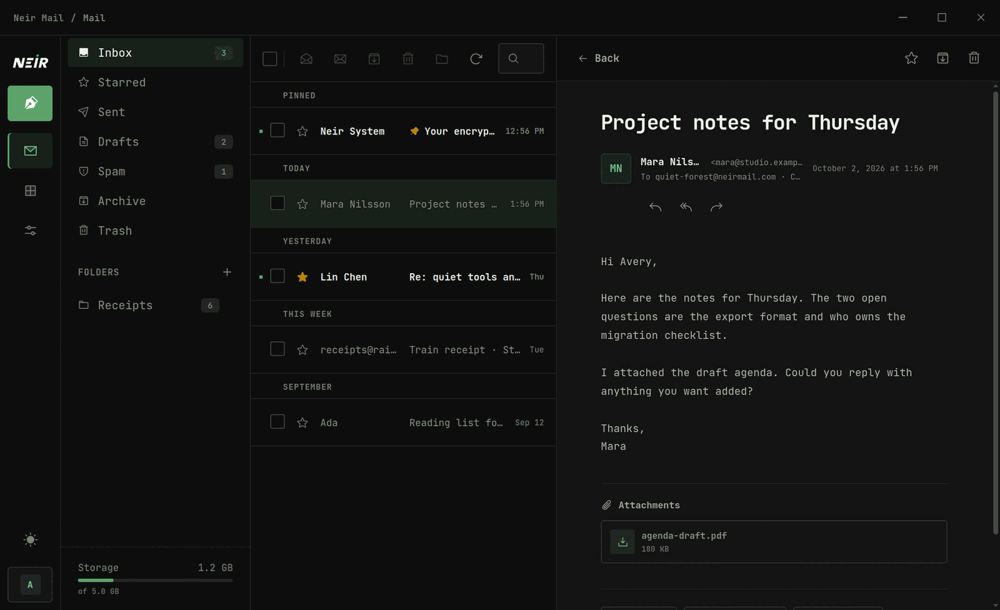
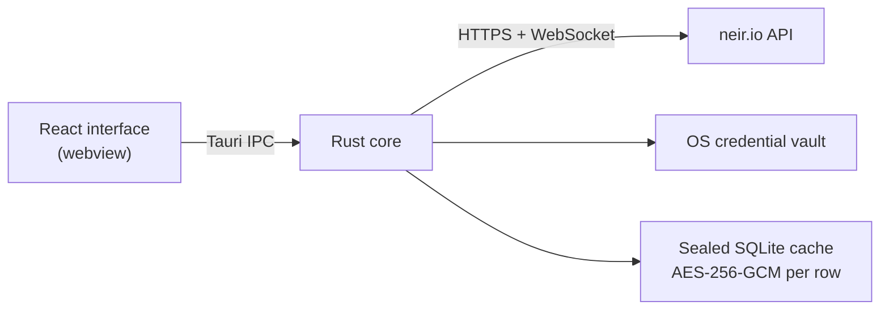

<div align="center">

<picture>
  <source media="(prefers-color-scheme: dark)" srcset="public/banner_v2_dark.png">
  <source media="(prefers-color-scheme: light)" srcset="public/banner_v2.png">
  
</picture>

<h3>Private email, native on your desktop.</h3>

<p>The official desktop client for <a href="https://neir.io">Neir.io</a>. Encrypted mail for Windows, macOS and Linux, built on Tauri and Rust.</p>

<p>
  <a href="https://github.com/marceltheking/Neirmail-Windows/releases/latest"></a>
  <a href="https://github.com/marceltheking/Neirmail-Windows/releases"></a>
  <a href="LICENSE"></a>
  <a href="https://v2.tauri.app"></a>
</p>

<p>
  <a href="https://github.com/marceltheking/Neirmail-Windows/releases/latest"><b>Download</b></a>
  &nbsp;&nbsp;|&nbsp;&nbsp;
  <a href="https://neir.io/signup"><b>Create an account</b></a>
  &nbsp;&nbsp;|&nbsp;&nbsp;
  <a href="https://neir.io/recovery">Recover a key</a>
  &nbsp;&nbsp;|&nbsp;&nbsp;
  <a href="https://neir.io/privacy">Privacy</a>
</p>

<br>

<sub><b>SPONSORED BY</b></sub>

<a href="https://sageswap.io/"></a>

<sub><a href="https://telegram.me/neir_io">Advertise here</a></sub>

<br><br>



</div>

<br>

## Why Neir Mail

<table>
  <tr>
    <td width="50%" valign="top">
      <h3>🔐 Keys never leave memory</h3>
      Your private key is decrypted locally with your Account Key and lives only in process memory. Nothing secret is ever written to disk in plaintext.
    </td>
    <td width="50%" valign="top">
      <h3>🦀 A Rust core, not a browser tab</h3>
      Networking, cookies, downloads, caching and notifications all run natively. The interface never talks to the network on its own.
    </td>
  </tr>
  <tr>
    <td width="50%" valign="top">
      <h3>⚡ Fast and live</h3>
      New mail appears instantly over a native WebSocket, with an encrypted local cache so your inbox opens before the network answers.
    </td>
    <td width="50%" valign="top">
      <h3>🛡️ Tracker-proof reading</h3>
      HTML email renders in a locked-down frame. Remote scripts, fonts, pixels and frames are blocked by a strict Content Security Policy.
    </td>
  </tr>
</table>

## Features

|              |                                                                                                            |
| :----------- | :--------------------------------------------------------------------------------------------------------- |
| **Sign in**  | Account Key login, TOTP two-factor, session restore, auto-lock after inactivity                            |
| **Mail**     | Folders, PGP decryption, attachments, drafts, scheduled send, undo send, reply all, forward, batch actions |
| **Compose**  | Plain text or formatted HTML, send from any alias, paste designed emails straight in                       |
| **Identity** | Primary addresses, custom and random aliases, plan status, storage use                                     |
| **Account**  | Contacts, filters, sessions, PGP keys, app passwords, 2FA, recovery phrase rotation, export                |
| **Desktop**  | Native notifications with sound, keyboard shortcuts, tray, signed auto-updates                             |
| **Look**     | Matching dark and light Neir themes, resizable split layout                                                |

> [!NOTE]
> The app signs in to existing accounts. Creating an account or recovering a lost Account Key happens on the web at [neir.io/signup](https://neir.io/signup) and [neir.io/recovery](https://neir.io/recovery).

## How it works



- **Frontend:** React, TypeScript, Vite, TanStack Query and Zustand.
- **Core:** Tauri 2 and Rust own transport, cookies, downloads, live updates, caching, notifications and updates.
- **Boundary:** the webview never calls the Neir API directly. A native `reqwest` client handles the cookie and CSRF boundary.
- **Cache:** mailbox metadata is stored in SQLite with every row sealed by AES-256-GCM, under a random key held in the operating system credential vault. Without a vault, the cache is disabled.
- **Files:** attachments can only be added through the native file picker. Rust refuses any other path.

<details>
<summary><b>Security model</b></summary>

<br>

Neir Mail does not persist plaintext Account Keys, recovery phrases, TOTP secrets or decrypted PGP private keys. API cookies are native state and requests do not cross the webview origin boundary. Downloads are streamed natively. The Content Security Policy blocks remote scripts, frames, plugins and arbitrary network access from the interface.

Email still follows the system boundaries described in the [Privacy Policy](https://neir.io/privacy): mail routing, filtering, IMAP, SMTP and standards-compatible Maildir storage are not zero-access unless the sender encrypts the message before delivery.

</details>

## Development

<details>
<summary><b>Prerequisites</b></summary>

<br>

| Tool           | Version                                                                        |
| -------------- | ------------------------------------------------------------------------------ |
| Node.js        | 24 or newer                                                                    |
| npm            | 11 or newer                                                                    |
| Rust           | stable                                                                         |
| Platform tools | see the [Tauri prerequisites guide](https://v2.tauri.app/start/prerequisites/) |

</details>

```bash
npm install
npm run tauri dev
```

Production is the default API target. Point a development build at another Neir backend with:

```bash
NEIRMAIL_API_BASE_URL=http://127.0.0.1:3099 npm run tauri dev
```

The backend must expose the same REST and WebSocket contract as `https://neir.io`. Release builds ignore this variable unless it points at an `https://` or `.onion` address.

<details>
<summary><b>Quality checks</b></summary>

<br>

```bash
npm run check
cd src-tauri
cargo fmt --check
cargo clippy --all-targets -- -D warnings
cargo test
```

</details>

<details>
<summary><b>Building installers</b></summary>

<br>

```bash
npm run tauri build
```

Build each public artifact on its target operating system so Tauri can produce native installers and signatures:

- **macOS** releases require Developer ID signing and notarization.
- **Windows** releases should use Authenticode signing.
- **Linux** produces Debian, RPM and AppImage bundles when their host tools are installed.

</details>

<details>
<summary><b>Signed updates and releases</b></summary>

<br>

The updater public key is embedded in `src-tauri/tauri.conf.json`. The matching private key and password stay outside the repository and are provided only to release CI:

```bash
TAURI_SIGNING_PRIVATE_KEY_PATH=/secure/path/updater.key \
TAURI_SIGNING_PRIVATE_KEY_PASSWORD='secret' \
npm run tauri build
```

Releases are built by the manually triggered `Release Neir Mail` GitHub Actions workflow. It validates the app, builds Linux x64, Windows x64, macOS Apple Silicon and macOS Intel installers, creates a GitHub Release, and uploads updater signatures and `latest.json`.

The updater checks `https://github.com/marceltheking/Neirmail-Windows/releases/latest/download/latest.json` first and falls back to `https://neir.io/downloads/latest.json`.

`current-version.json`, `package.json` and `src-tauri/tauri.conf.json` must share the same version:

```bash
npm run version:check
```

Update all three files and commit before running the release workflow. Rotating or losing the updater signing key breaks the update chain for installed clients. The workflow uses ad-hoc signing for macOS so unsigned development releases open correctly; trusted distribution still requires Apple Developer ID notarization and Windows Authenticode secrets.

</details>

## License

Licensed under [AGPL-3.0-or-later](LICENSE).

<div align="center">
<br>
<sub>Made with care for <a href="https://neir.io">Neir.io</a></sub>
</div>
